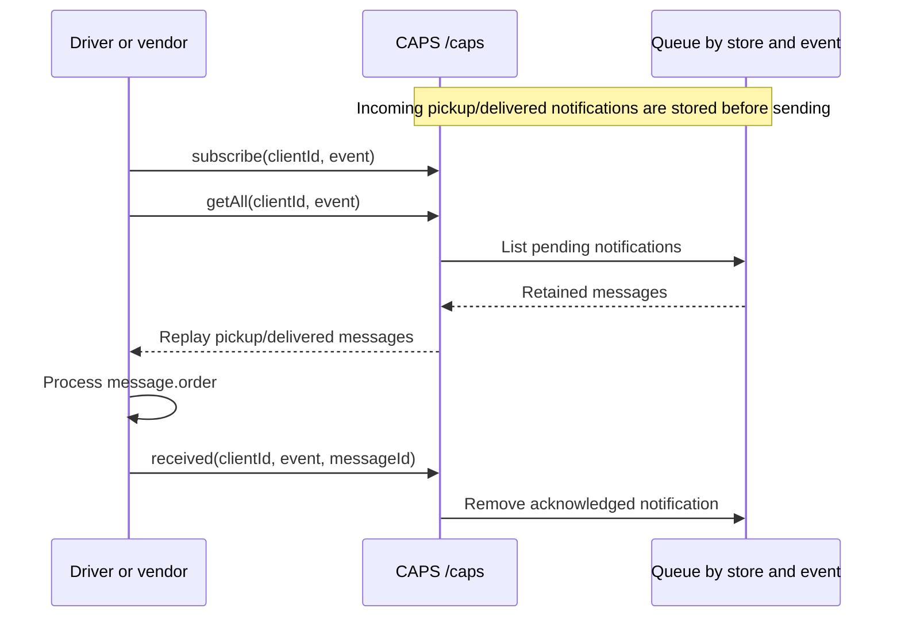
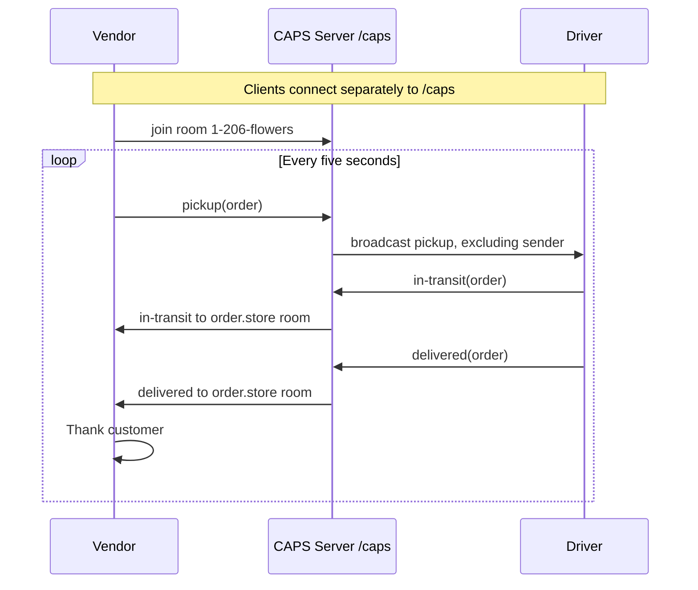
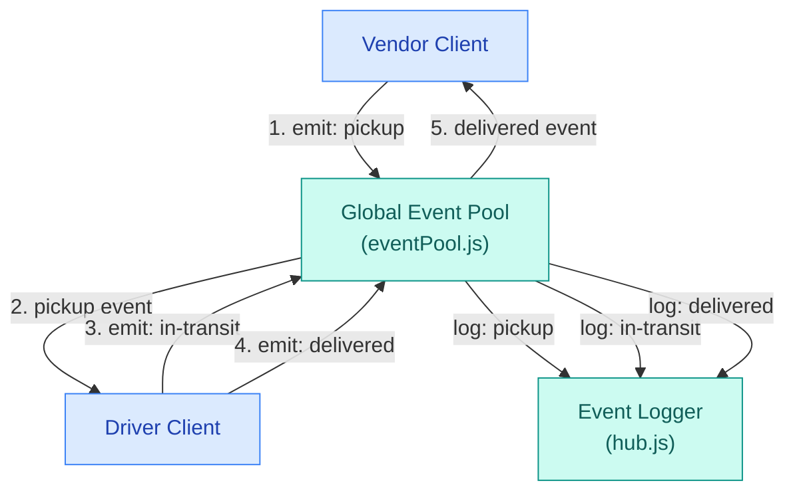
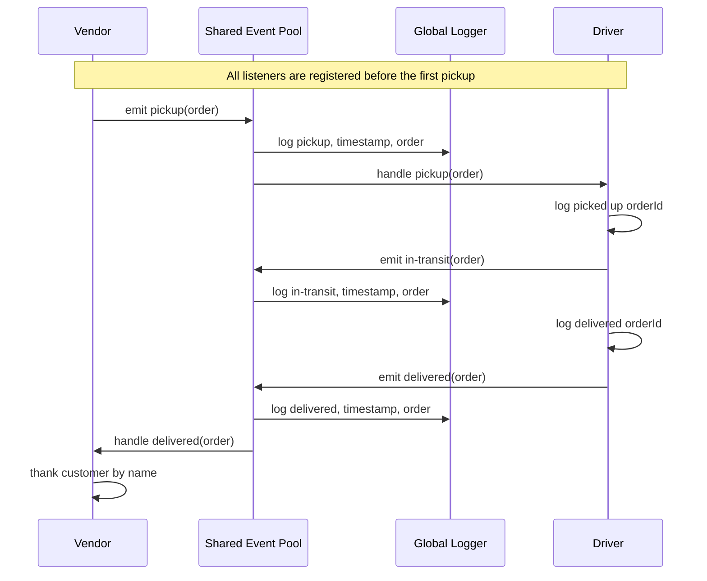

# CA_ParcelServ

A Node.js parcel-delivery simulation using Socket.IO, the `/caps`
namespace, and vendor-specific rooms.

Implemented: networked vendor pickup requests, driver delivery simulation,
customer confirmation, timestamped server logging, and Socket.IO handler tests.

Lab 11, Lab 12, and Lab 13 GitHub Actions passed.

Lab 11 submitted.  
PR [Link](https://github.com/tonch-LIV/CA_ParcelServ/pull/1)  
Lab 12 network flow, local tests, and CI verified; Submitted.  
PR [Link](https://github.com/tonch-LIV/CA_ParcelServ/pull/2)  
Lab 13 queue storage, offline catch-up, acknowledgment removal, local tests, and CI verified; Submitted.  
PR [Link](https://github.com/tonch-LIV/CA_ParcelServ/pull/3)

## Setup and Usage

Requires Node.js and npm.  
Local verification used Node.js 20.20.2.

Install dependencies:

```bash
npm ci
```

Start each application in a separate terminal:

1. Server: `npm start`.
2. Driver: `npm run driver`.
3. Widgets vendor: `npm run vendor -- acme-widgets`.
4. Flowers vendor: `npm run vendor -- 1-800-flowers`.

Vendors create orders immediately, then every five seconds.
Reconnecting clients retrieve pending notifications automatically.
Queues remain available while the server stays running.
Stop applications with Ctrl+C.

## Testing

Run the handler tests with coverage:

```bash
npm test -- --runInBand
```

Tests cover queue retention and isolation, subscriptions, publication, catch-up, acknowledgment removal, client notifications, and interval cleanup.  

Real network delivery and offline catch-up were verified manually using
the server, driver, and two vendor applications.  

GitHub Actions is configured to run the suite on pushes and pull requests.

## UML

### Lab 13 Catch-Up and Acknowledgment



### Lab 12 Network Flow



### FlowChart

#### Lab 11 Reference



**Diagram Walkthrough** 

1. **Vendor**: Simulates a customer's order and emits `pickup`, supplying the order's information.
2. **Event Pool**: Receives the event and notifies subscribed listeners, including the driver and logger.
3. **Driver**: Responds to `pickup` and emits `in-transit`, followed by `delivered`, using the same order payload.
4. **Event Logger**: Listens for all three event types and logs the event name, ISO timestamp, and order payload.
5. **Vendor**: Receives the `delivered` notification and thanks the customer.

### Sequence Diagram

#### Lab 11 Reference



Top to bottom  

1. **Vendor creates the order**. Its store name comes from a function parameter. The payload contains `store`, `orderId`, `customer`, and `address`.
2. **The event pool announces `pickup`**. The logger and driver each respond through their registered listeners.
3. **The driver advances the delivery**. It emits `in-transit`, then `delivered`, passing along the same order payload.
4. **The vendor responds to delivery**. It thanks the customer named in that payload.

## Changelog

- created assignment branch; `events`.
  - added UMLs
  - installed jest
  - `package.json`;
    - ran `npm init -y`,
    - installed and configured `jest` as dev dependency and application scripts -> `package-lock.json`,
    - updated `main`, `script.start`, and `.test`, as well as `description`,
  - added shared event pool and timestamped package logging; `eventPool.js`, `hub.js`.
  - connected vendor pickup requests, driver delivery, and customer confirmation; `vendor/`, `driver/`, `hub.js`.
  - added vendor, driver, and logger unit tests with application coverage reporting; `vendor/vendor-handler.test.js`, `driver/driver-handler.test.js`, `hub.test.js`, `jest.config.js`.
  - verified connected vendor-to-driver delivery and customer confirmation; `delivery-flow.test.js`.
  - configured automated tests for pushes and pull requests; `.github/workflows/node.yml`.
- created assignmnet branch; `sockets`.
  - installed `socket.io@4` `socket.io-client@4`; `package.json`, `package-lock.json`.
  - updated project `main`, `start`, and `descriptiom`; `package.json`.
  - added the CAPS namespace, vendor-room joins, and package-event routing; `server/index.js`, `server/handler.js`.
  - connected vendor and driver through Socket.IO with recurring orders and vendor-room delivery notifications; `socket.js`, `vendor/`, `driver/`.
  - corrected disconnect cleanup and adapted tests for socket emissions and server routing; `vendor/index.js`, client handler tests, `server/server-handler.test.js`.
  - retired the Node event pool and obsolete tests; `eventPool.js`, `hub.js`, `hub.test.js`, `delivery-flow.test.js`.
  - updated application coverage and network architecture documentation; `jest.config.js`, `README.md`.
- created assignment branch for message-queue implementation; `queues`.
  - added notification storage, non-destructive retrieval, and acknowledgment removal with unit tests; `server/queue.js`, `server/queue.test.js`.
  - integrated subscriptions, acknowledgment removal, and notification replay; `server/handler.js`, `server/index.js`.
  - added two vendor identities and client catch-up on connection; `vendor/`, `driver/`.
  - adapted handler tests for queued payloads, subscriptions, replay, and acknowledgment removal; client handler tests, `server/server-handler.test.js`.
  - documented the notification acknowledgment lifecycle; `README.md`.

## AI Assistance

- Codex supplied UML drafts, architecture review, setup guidance, application code, unit and connected-flow tests, coverage configuration, and the GitHub Actions workflow.