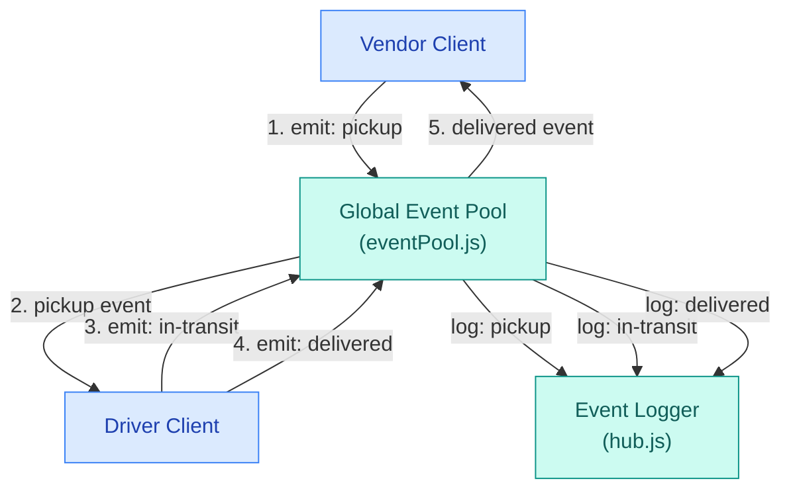
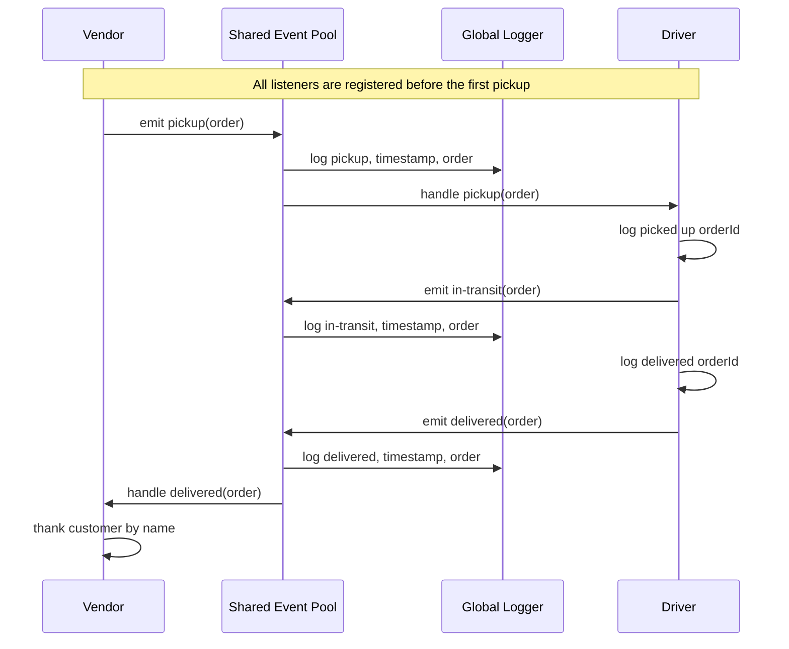

# CA_ParcelServ

A Node.js parcel-delivery simulation using a shared event pool.

Implemented: vendor pickup requests, driver delivery simulation, customer
confirmation, and timestamped logging through a shared event pool.

Pending: automated tests and GitHub Actions.

## UML

### FlowChart

**Diagram Walkthrough** 

1. **Vendor**: Simulates a customer's order and emits `pickup`, supplying the order's information.
2. **Event Pool**: Receives the event and notifies subscribed listeners, including the driver and logger.
3. **Driver**: Responds to `pickup` and emits `in-transit`, followed by `delivered`, using the same order payload.
4. **Event Logger**: Listens for all three event types and logs the event name, ISO timestamp, and order payload.
5. **Vendor**: Receives the `delivered` notification and thanks the customer.

### Sequence Diagram

Top to bottom  

1. **Vendor creates the order**. Its store name comes from a function parameter. The payload contains `store`, `orderId`, `customer`, and `address`.
2. **The event pool announces `pickup`**. The logger and driver each respond through their registered listeners.
3. **The driver advances the delivery**. It emits `in-transit`, then `delivered`, passing along the same order payload.
4. **The vendor responds to delivery**. It thanks the customer named in that payload.

## Changelog

- created assignment branch; `events`.
- added UMLs
- installed jest
- `package.json`;
  - ran `npm init -y`,
  - installed and configured `jest` as dev dependency and application scripts -> `package-lock.json`,
  - updated `main`, `script.start`, and `.test`, as well as `description`,
- added shared event pool and timestamped package logging; `eventPool.js`, `hub.js`.
- connected vendor pickup requests, driver delivery, and customer confirmation; `vendor/`, `driver/`, `hub.js`.
  
## AI Assistance

- Codex supplied UML drafts, architecture review, setup guidance, and event-pool, logger, vendor, and driver code.